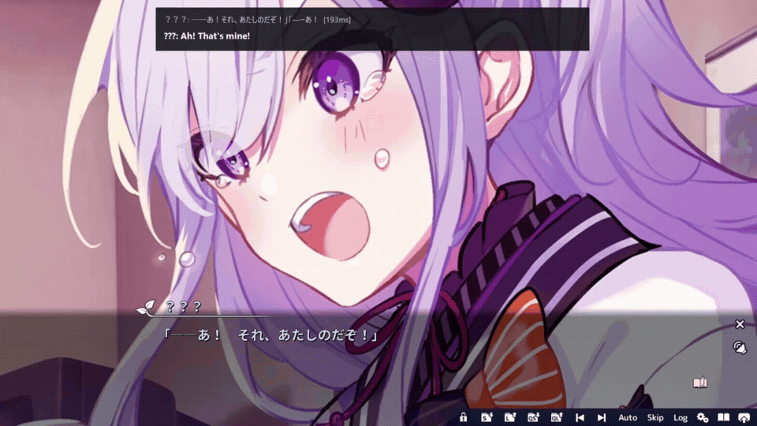

# Real-Time Offline Japanese Visual Novel Translator

An end-to-end, low-latency (~300–450 ms) offline Japanese-to-English screen translator built specifically for Visual Novels on Windows. Combines a custom **YOLO UI/text-line detector**, a custom **CRNN + CTC Japanese OCR model** exported to ONNX, domain-specific **SudachiPy NLP post-processing**, and **Sugoi V4 (CTranslate2)** running inside a self-excluding transparent overlay.


<sub>*Demo footage captured running on **Perennial Dusk -Kinsenka-**.*</sub>
---

## System Architecture


## Key Features
Zero-Configuration Full-Screen Detection: Automatically detects and classifies speaker names, dialogue lines, and branching choice prompts directly from full-screen frames (1280px), ignoring game logos, sprites, and quick-save toolbars.

Custom Japanese CRNN OCR: Trained from scratch using a 6-stage data curation and active-learning pipeline (pipeline/1_crop_lines.py → 6_find_noisy_labels.py) with synthetic TRDG augmentation for game fonts, ruby-free kanji, ellipses, and Japanese brackets.

100% Offline & Hardware-Adaptive: Runs on NVIDIA GPUs (CUDA 12 FP16) when cublas64_12.dll is available, and automatically falls back to multi-threaded CPU INT8 (CTranslate2 + ONNX Runtime) without requiring a 3 GB CUDA Toolkit installation.

Feedback-Loop-Proof Overlay: Uses Windows SetWindowDisplayAffinity(WDA_EXCLUDEFROMCAPTURE) paired with live coordinate masking so the overlay never re-captures or re-translates its own rendered text.

## Project Structure
```
realtime-japanese-visual-novel-translator/
├── runtime/                     # Lightweight PyTorch-free inference runtime
│   ├── detector_onnx.py         # Full-screen YOLO detector (speaker, dialogue, choice)
│   ├── ocr_onnx.py              # ONNX CRNN recognizer with aspect-preserving padding
│   ├── postprocess.py           # Speaker extraction, bracket normalization & SudachiPy OOV check
│   ├── translator_sugoi.py      # CTranslate2 Sugoi V4 wrapper with LRU translation cache
│   └── device_utils.py          # Runtime CUDA/cuBLAS probing + graceful CPU INT8 fallback
├── model/                       # CRNN model architecture, dataset loader & character vocabulary
│   ├── crnn.py
│   ├── dataset.py
│   └── vocab.json
├── pipeline/                    # End-to-end dataset curation & quality-control pipeline
│   ├── 1_crop_lines.py          # Automated line extraction from raw VN captures
│   ├── 2_deduplicate.py         # Perceptual hash deduplication
│   ├── 3_prelabel.py            # Automated silver-label generation
│   ├── 4_audit_gui.py           # Custom Tkinter GUI for rapid human label verification
│   ├── 5_generate_trdg.py       # Synthetic Japanese text line generation across VN fonts
│   └── 6_find_noisy_labels.py   # CTC loss / confidence-based noisy label mining
├── realtime_translator.py       # Main real-time capture, debounce & overlay entry point
├── train.py                     # CRNN training script
├── export_onnx.py               # Exports PyTorch CRNN checkpoint -> weights/crnn_vn.onnx
├── export_detector_onnx.py      # Exports YOLO detector -> weights/vn_detector.onnx
├── download_sugoi.py            # Downloads & verifies Sugoi V4 CTranslate2 weights
└── requirements.txt             # Minimal runtime dependencies
```

## Quick Start
### 1. Install Runtime Dependencies
```bash
git clone [https://github.com/](https://github.com/)<your-username>/realtime-japanese-visual-novel-translator.git
cd realtime-japanese-visual-novel-translator

python -m venv .venv
.venv\Scripts\activate
pip install -r requirements.txt
```

### 2. Download Model Weights
```bash
python download_sugoi.py
```
Download `vn_detector.onnx` and `crnn_vn.onnx` from the [GitHub Releases](https://github.com/Xreactives/realtime-japanese-visual-novel-translator/releases) page and place them inside `weights/`.

### 3. Run the Translator
```bash
python realtime_translator.py
```
Drag the top overlay bar to reposition it anywhere on screen.

Press ESC while focused on the overlay to exit.

## Training & Exporting Models from Scratch
To reproduce the dataset curation, training, and ONNX export pipeline:

```bash
pip install -r requirements-train.txt

# 1. Curate & audit dataset lines
python pipeline/1_crop_lines.py
python pipeline/2_deduplicate.py
python pipeline/3_prelabel.py
python pipeline/4_audit_gui.py
python pipeline/5_generate_trdg.py
python pipeline/6_find_noisy_labels.py

# 2. Train CRNN & export weights to ONNX
python train.py
python export_onnx.py
python export_detector_onnx.py
```
## Engineering Highlights & Problems Solved
1. Eliminating Overlay Capture Feedback Loops: Because the detector inspects full-screen frames, a standard topmost overlay triggers infinite re-translation loops. Combining Windows WDA_EXCLUDEFROMCAPTURE with live bounding-box masking eliminates self-detection at both the OS compositor and frame-buffer levels.

2. Preventing SentencePiece <unk> Artifacts (??) in Sugoi V4: Visual novel speaker tags (【天音】) and outer quotation marks (「…」) produce out-of-vocabulary artifacts in neural MT. The post-processor separates speaker tags from dialogue bodies, normalizes half-width/full-width punctuation, collapses multi-dot ellipses, and translates each choice box independently.

3. Resolving Windows DPI Scaling & Missing cuBLAS Crashes: Enforces Per-Monitor DPI Awareness (SetProcessDpiAwareness(2)) prior to window creation so mss and Tkinter share exact 1:1 physical coordinates, and probes cublas64_12.dll via ctypes before initializing CUDA so machines with NVIDIA drivers—but no system-wide CUDA Toolkit—fall back seamlessly to CPU INT8.

4. Fast-Advance Change Detection: Evaluates pixel drift and frame stability specifically across the lower 75% dialogue/choice ROI rather than full-screen averages, preventing skipped lines when rapidly advancing dialogue over static backgrounds.